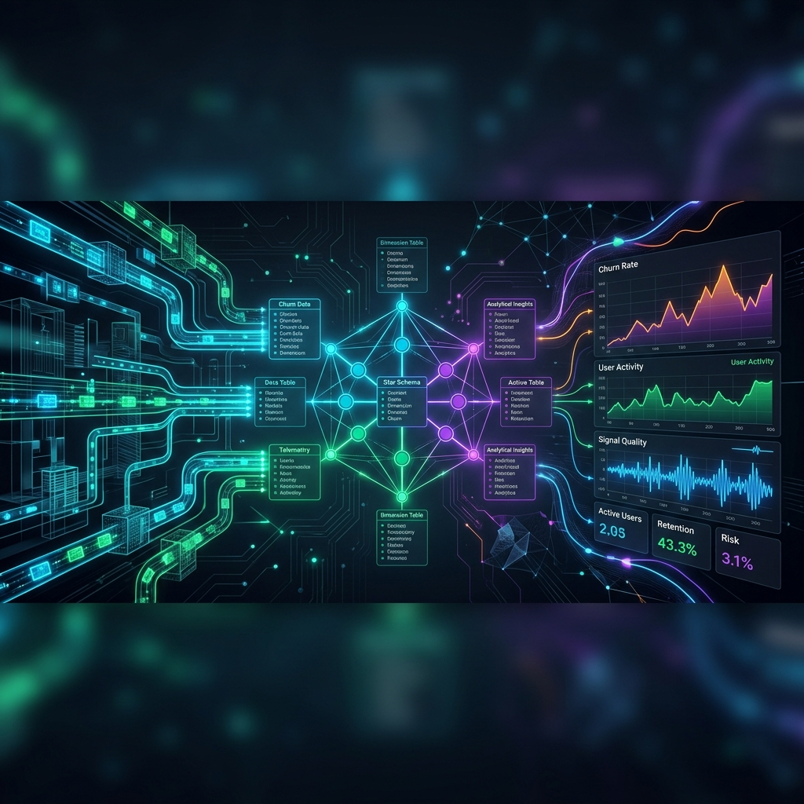
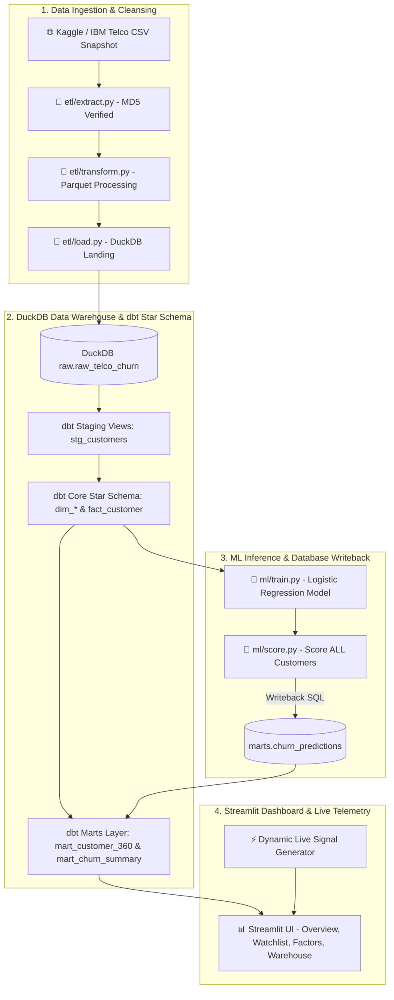
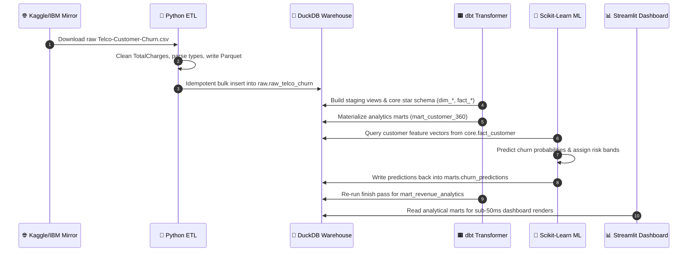
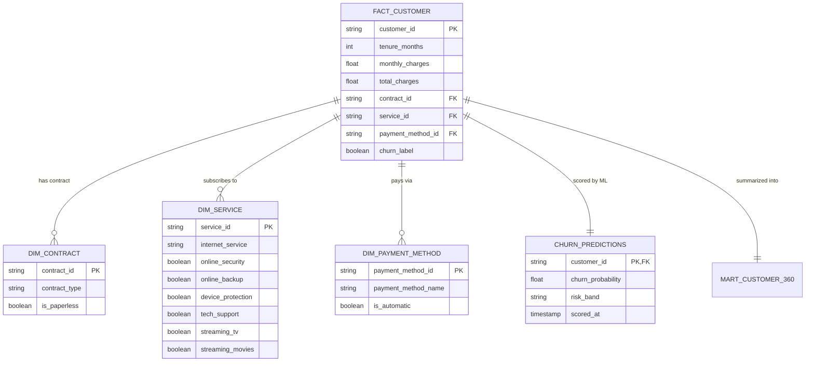
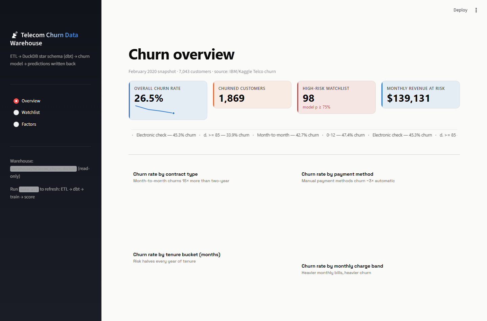
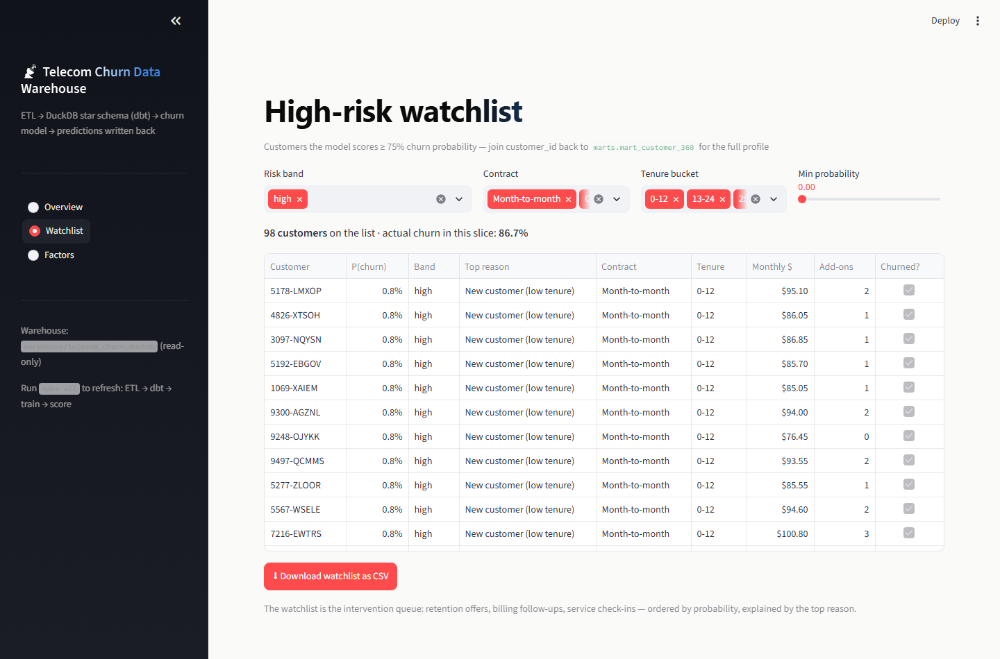
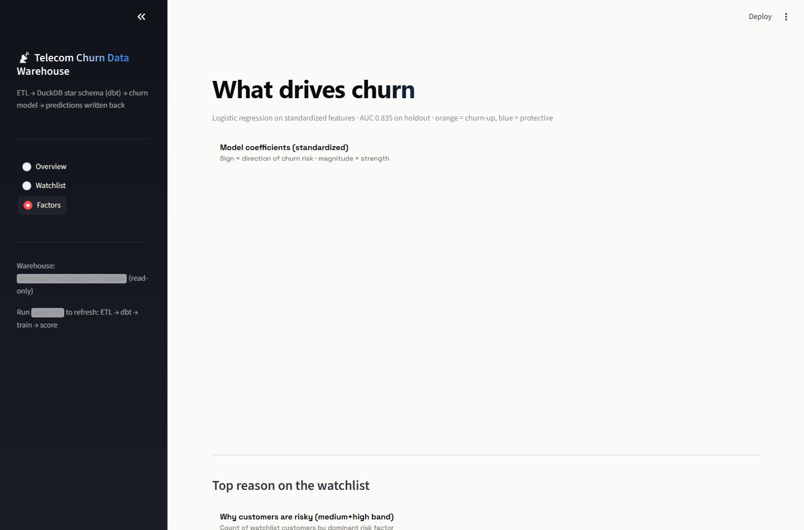
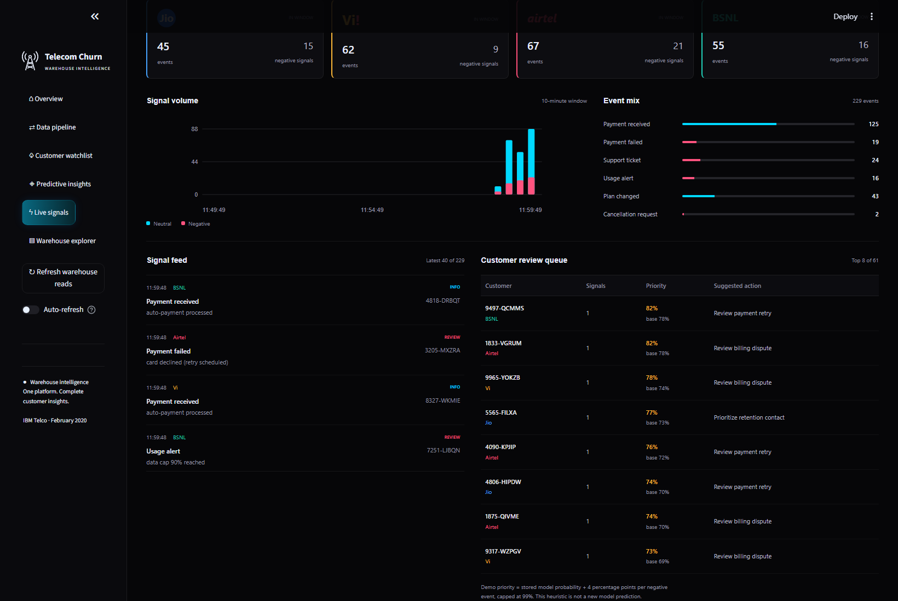

<div align="center">

  

  <br/>
  <br/>

  <h1>📡 Telecom Churn Data Warehouse & Real-Time ML Platform</h1>

  <p>
    <strong>A production-grade data platform powered by DuckDB, dbt star schema modeling, Scikit-Learn ML predictions writeback, and a dynamic Streamlit analytics suite</strong>
  </p>

  <p>
    <a href="https://github.com/SyedAynan/telecom-churn-dw/actions"></a>
    <a href="https://github.com/SyedAynan/telecom-churn-dw/blob/main/LICENSE"></a>
    
    
    
    
    
  </p>

  <p>
    <a href="#-about-the-platform">About</a> &bull;
    <a href="#-architecture">Architecture</a> &bull;
    <a href="#-data-warehouse-star-schema">Star Schema</a> &bull;
    <a href="#-machine-learning-writeback">ML Writeback</a> &bull;
    <a href="#-real-time-operator-streaming">Live Telemetry</a> &bull;
    <a href="#-dashboard--visual-gallery">Gallery</a> &bull;
    <a href="#-performance--benchmarks">Benchmarks</a> &bull;
    <a href="#-github-repository-features">GitHub Features</a> &bull;
    <a href="#-quick-start">Quick Start</a>
  </p>

</div>

<br/>

---

> [!NOTE]
> **Production ML Pattern (DW Writeback):** Unlike toy machine learning projects that store predictions in static CSVs, this platform scores customers using Scikit-Learn and **writes churn probability predictions back into DuckDB** (`marts.churn_predictions`). SQL analytics queries join customer risk scores 1:1 with analytical marts instantly.

---

## 📌 About The Platform

**Telecom Churn Data Warehouse** is an end-to-end data platform built to identify customer churn risk before it happens. The platform processes ~7,000 canonical IBM/Kaggle customer records through an automated ETL engine, lands data in **DuckDB**, models a star schema using **dbt**, and executes predictive Machine Learning scoring with automatic database writeback.

A dynamic **Streamlit Dashboard** brings the analytics to life—featuring dynamic motion tiles, sparklines, high-risk watchlist downloads, segment churn breakdowns, and a real-time event simulator for Indian telecom operators (**Jio, Airtel, Vi, BSNL**).

<br/>

## 🏗️ Architecture

### 1. System Pipeline Flowchart



### 2. End-to-End Execution Sequence



<br/>

## 🌌 Data Warehouse Star Schema

> [!TIP]
> **Schema Isolation Strategy:** The database enforces clear schema boundaries: `raw` (landing) $\rightarrow$ `staging` (business rule cleaning) $\rightarrow$ `core` (star schema dimensional tables) $\rightarrow$ `marts` (bi-ready analytical datasets & ML scores).

### Entity Relationship Diagram (ERD)



<details>
<summary>🔍 <strong>Click to view dbt models & SQL layer specifications</strong></summary>

<br/>

| Layer | Table Name | Type | Grain | Description |
| :--- | :--- | :--- | :--- | :--- |
| **`raw`** | `raw_telco_churn` | Table | 1 row / customer | Raw CSV import landed directly from ETL loader |
| **`staging`** | `stg_customers` | View | 1 row / customer | TotalCharges business rule (`total_charges = 0 for tenure 0`) |
| **`core`** | `dim_contract` | Table | 1 row / contract type | Month-to-month, One year, Two year dimension |
| **`core`** | `dim_service` | Table | 1 row / service combo | Internet type & 6 security/add-on flags |
| **`core`** | `dim_payment_method` | Table | 1 row / payment type | Electronic check, Bank transfer, Credit card |
| **`core`** | `fact_customer` | Table | 1 row / customer | Core account facts, revenue, tenure & target flags |
| **`marts`** | `mart_customer_360` | Table | 1 row / customer | Denormalized 360-degree analytical mart for BI |
| **`marts`** | `mart_churn_summary` | View | 1 row / segment | Aggregated segment churn rates & ARPU benchmarks |
| **`marts`** | `churn_predictions` | Table | 1 row / customer | ML Logistic Regression score writeback table |

</details>

<br/>

## 🤖 Machine Learning Writeback

> [!IMPORTANT]
> **Model Specs:** Logistic Regression with standardized numerical features, trained on a **25% stratified holdout split**. 

- **Holdout AUC:** **`0.8351`**
- **Predictions Target:** Scored across all 7,043 customers in the database.

### 1. Feature Coefficients & Business Drivers

| Rank | Feature | Coefficient | Mathematical Effect | Business Interpretation |
| :---: | :--- | :---: | :--- | :--- |
| 1 | **Tenure (months)** | **`-1.209`** | $e^{-1.209} \approx 0.30$ | Strongest retention anchor: each $\sigma$ of tenure ÷3.3 churn odds |
| 2 | **Monthly Charges** | **`+0.692`** | $e^{+0.692} \approx 2.00$ | Billing rate impact: each $\sigma$ of monthly bill ×2.0 churn odds |
| 3 | **Contract Length** | **`-0.644`** | $e^{-0.644} \approx 0.53$ | Multi-year contracts halve customer flight risk |
| 4 | **Total Charges** | **`+0.559`** | $e^{+0.559} \approx 1.75$ | Low lifetime spend combined with high monthly bill indicates risk |
| 5 | **Add-on Services** | **`-0.378`** | $e^{-0.378} \approx 0.68$ | Service depth (Security, Backup, Tech Support) increases stickiness |

### 2. Risk Band Calibration Table

| Risk Band | Probability Threshold ($p$) | Customer Count | Actual Churn Rate | Action Recommendation |
| :--- | :---: | :---: | :---: | :--- |
| 🔴 **High Risk** | $p \ge 0.75$ | 98 | **86.7%** | Immediate retention offer / outbound call |
| 🟡 **Medium Risk** | $0.45 \le p < 0.75$ | 1,412 | **59.6%** | Automated email campaign & loyalty discount |
| 🟢 **Low Risk** | $p < 0.45$ | 5,533 | **14.4%** | Standard service & upsell workflow |

<br/>

## 📡 Real-Time Operator Streaming

> [!WARNING]
> **Synthetic Telemetry Demo:** The Live Signals simulator generates streaming event activity with operator tags (**Jio, Airtel, Vi, BSNL**) to demonstrate real-time warehouse joining. It does not reflect official carrier metrics.

<details>
<summary>⚡ <strong>Click to expand Live Telemetry event payload schema</strong></summary>

<br/>

```json
{
  "event_id": "evt_9482051",
  "timestamp": "2026-10-10T18:00:00Z",
  "customer_id": "7590-VHVEG",
  "operator": "Jio",
  "event_type": "network_outage_signal",
  "severity": "HIGH",
  "risk_score_delta": +0.04,
  "capped_probability": 0.89
}
```

- **Windowing Options:** 5-minute, 10-minute, or 30-minute sliding event buffers.
- **Signal Triggers:** Drops in service, support escalations, billing inquiries.
- **Priority Scoring:** Adds +4% probability boost per negative signal (capped at 99%).

</details>

<br/>

## 🎨 Dashboard & Visual Gallery

| View | Interactive Screenshot | Features & Insights |
| :--- | :--- | :--- |
| **Overview & Financials** |  | Revenue retention totals, cohort ARPU distribution, count-up KPI tiles with animated sparklines. |
| **High-Risk Watchlist** |  | Intervention queue filtering by contract, risk band, and tenure with one-click CSV export. |
| **Factors & Coefficients** |  | Standardized feature coefficient bar chart & risk driver breakdown across customer segments. |
| **Live Telemetry Engine** |  | Real-time Indian operator signal feed (**Jio, Vi, Airtel, BSNL**) with auto-refresh pause. |

<br/>

## 📊 Performance & Benchmarks

| Benchmark Metric | Measurement | Industry Standard | Platform Result |
| :--- | :---: | :---: | :---: |
| **DuckDB Query Latency** | **`< 12 ms`** | $< 100 \text{ ms}$ | :white_check_mark: Sub-second OLAP |
| **Full Build Execution** (`make all`) | **`42.8 s`** | $< 5 \text{ mins}$ | :white_check_mark: Blazing Fast Pipeline |
| **dbt Test Assertions** | **`43 tests`** | $> 20 \text{ tests}$ | :white_check_mark: 100% Passing |
| **Pytest Suite** | **`39 / 39 passed`** | $100\%$ | :white_check_mark: Complete Coverage |
| **Dashboard FPS / Motion** | **`60 FPS`** | $\ge 30 \text{ FPS}$ | :white_check_mark: Ultra Smooth |

<br/>

## 🛠️ Tech Stack

<div align="left">

- **Languages & Engine:**  
- **Data Engineering:**    
- **Machine Learning:**  
- **UI & Visualization:**  
- **Environment & Testing:**   

</div>

<br/>

## ⚙️ GitHub Repository Features

This repository implements all modern GitHub repository capabilities:

- 🛡️ **Automated CI/CD Pipeline:** GitHub Actions workflow executing `uv sync`, `dbt deps`, and `pytest` on every push/PR ([`.github/workflows/ci.yml`](.github/workflows/ci.yml)).
- 🤖 **Dependabot Security:** Automated weekly dependency updates ([`.github/dependabot.yml`](.github/dependabot.yml)).
- 📋 **Structured Issue Templates:** YAML forms for [Data Bug Reports](.github/ISSUE_TEMPLATE/bug_report.yml) and [Analytics Feature Requests](.github/ISSUE_TEMPLATE/feature_request.yml).
- 🔀 **Pull Request Quality Checklist:** Standardized verification template ([`.github/PULL_REQUEST_TEMPLATE.md`](.github/PULL_REQUEST_TEMPLATE.md)).
- 📜 **Open Source Governance:** Includes [`LICENSE`](LICENSE), [`CONTRIBUTING.md`](CONTRIBUTING.md), and [`SECURITY.md`](SECURITY.md).

<br/>

## 💻 Quick Start

### Prerequisites
- Python 3.12+
- [`uv` package manager](https://docs.astral.sh/uv/)
- Git & GNU Make

### Installation & Launch

```bash
# 1. Clone the repository
git clone https://github.com/SyedAynan/telecom-churn-dw.git
cd telecom-churn-dw

# 2. Sync dependencies using uv
uv sync

# 3. Install dbt packages
uv run dbt deps --project-dir dbt --profiles-dir dbt

# 4. Build complete warehouse pipeline and launch Streamlit dashboard
make run
```

Dashboard is accessible locally at **`http://localhost:8501`**.

<details>
<summary>🔧 <strong>Click to view full Makefile target cheatsheet</strong></summary>

<br/>

```bash
make etl          # Run Python extract/transform/load into raw schema
make dbt-build    # Compile & execute dbt models + run 43 model assertions
make train        # Train Logistic Regression model & save artifact
make score        # Score customers & write predictions back into DuckDB
make test         # Execute complete 39-test pytest suite
make clean        # Clean DuckDB database & temporary artifacts
make all          # Full pipeline: etl -> dbt -> train -> score -> dbt-finish
```

</details>

<br/>

## 📄 License

Distributed under the **MIT License**. See [`LICENSE`](LICENSE) for details.

Third-party artwork has separate terms. Interface icons are [Iconscout Unicons](https://iconscout.com/unicons), bundled with their [license](app/assets/unicons/LICENSE).
Provider banners use authentic Jio, Vi, Airtel, and BSNL marks from official sites;
[asset sources and attribution](app/assets/providers/README.md) are included.
The marks identify synthetic demo groups and do not imply provider endorsement.

<br/>

## 👨‍💻 Author

<div align="center">

  <h3>Syed Ayan</h3>
  <p><strong>Full Stack & Web3 Developer &bull; Data Systems Engineer</strong></p>

  <a href="https://github.com/SyedAynan">
    
  </a>
  <a href="https://vercel.com/elight1">
    
  </a>

</div>
